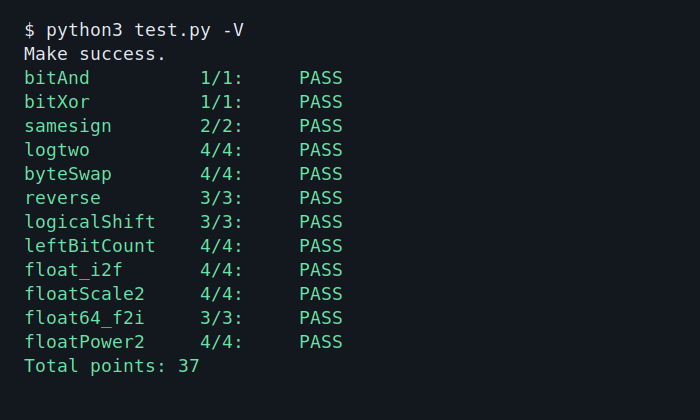

# DataLab 实验报告

姓名：董博睿

学号：2025201747

## 测试结果

在项目根目录运行 `python3 test.py -V`，12 个函数的正确性与脚本合规性检查全部通过，总分为 **37/37**，编译无警告。

下表的分值和操作次数以 `test.py` 的实际输出为准。

| 函数 | 得分 | 操作次数 | 次数上限 |
| --- | --- | --- | --- |
| bitAnd | 1/1 | 4 | 7 |
| bitXor | 1/1 | 7 | 7 |
| samesign | 2/2 | 7 | 12 |
| logtwo | 4/4 | 18 | 25 |
| byteSwap | 4/4 | 12 | 17 |
| reverse | 3/3 | 23 | 30 |
| logicalShift | 3/3 | 9 | 20 |
| leftBitCount | 4/4 | 33 | 50 |
| float_i2f | 4/4 | 20 | 30 |
| floatScale2 | 4/4 | 12 | 30 |
| float64_f2i | 3/3 | 19 | 60 |
| floatPower2 | 4/4 | 9 | 30 |
| **合计** | **37/37** | — | — |

测试输出见下图，原始文本保存在同目录的 `test-output.txt`。



## 解题报告

### 亮点

1. **`float_i2f`：一次加法完成舍入和指数进位。**
   先判断是否需要按“最近偶数”规则进位，再直接给组装好的浮点编码加 1。尾数若溢出，进位会自然传入指数域，省去额外分支。

2. **`leftBitCount`：把连续高位 1 转化为最高有效位定位。**
   先取反，再二分查找最高有效位；最后用 `!y` 补偿全 1 输入，把一般情况与返回 32 的特例统一起来。

### 1. bitAnd：利用德摩根律

由 `x & y = ~(~x | ~y)`，先对两个输入取反，再取或并整体取反，即可仅用 `~` 和 `|` 实现按位与，共 4 次操作。逐位看，只有两个输入位都为 1 时，结果位才为 1。

### 2. bitXor：排除“同时为 1”和“同时为 0”

异或要求两个输入位不同。`~(x & y)` 排除两个位同时为 1 的情况，`~(~x & ~y)` 排除两个位同时为 0 的情况，再将两者按位与：

```c
~(x & y) & ~(~x & ~y)
```

这样只使用 `~` 和 `&`，恰好达到 7 次操作的上限。

### 3. samesign：先区分零，再比较符号位

题目将零单独划为一类，因此不能只比较最高位。先处理含零输入：两者都为零返回 1，只有一个为零返回 0。对两个非零输入，算术右移 31 位得到符号掩码，再用 `!((x >> 31) ^ (y >> 31))` 判断符号是否一致。整个过程不求绝对值，也能处理 `INT_MIN`。

### 4. logtwo：二分定位最高有效位

正整数的向下取整二进制对数等于最高有效位的下标。依次判断当前值是否超过 `0xffff`、`0xff`、`0xf`、`0x3` 和 `0x1`，对应判断最高有效位是否还在上方的 16、8、4、2、1 位范围内；满足条件就右移相应位数，继续缩小范围。

比较结果为 0 或 1，将它左移即可产生本轮位移量，不需要 `if`。结果中的 16、8、4、2、1 分别占据不同二进制位，因此可以用 `|` 累积位移量。例如 `v=40` 时依次贡献 4 和 1，得到 5。

### 5. byteSwap：只翻转两个字节的差异位

令两个待交换字节为 A 和 B，先计算 `diff = A ^ B`。由于 `A ^ diff = B`、`B ^ diff = A`，将 `diff` 分别移回两个字节的位置并异或到原数上，就完成交换，无须先清空两个字节。

`& 0xff` 去掉右移后其他字节的内容。若 `n == m`，则 `diff == 0`，结果自然保持原值。

当前代码通过 `diff & 0xffu` 将后续左移置于无符号类型下，避免差异位移入最高位时发生有符号左移溢出。这依赖隐式无符号转换；脚本检查通过，但 README 对此要求尽量避免，人工验收时仍需说明。这一问题尚未消除：试验中的纯 `int` 安全版本使用了 24 次操作，因超过 17 次而被扣除本题分数，最终保留当前 12 次操作的版本。

### 6. reverse：逐层交换相邻位块

按 1、2、4、8、16 位的粒度，依次交换相邻的等长位块。前四轮使用 `0x55555555`、`0x33333333`、`0x0f0f0f0f`、`0x00ff00ff` 分离两组位，再分别向相反方向移动并合并；最后直接交换高低 16 位。

每完成一轮，已处理位块内部的顺序就反转完成。五轮之后整个 32 位字的位序被反转，共 23 次操作。变量为无符号类型，右移补零，左移也按无符号规则处理。

### 7. logicalShift：用掩码清除符号扩展

先进行算术右移，再用掩码保留最低 `32-n` 位。对于 `n > 0`，掩码可由 `0x7fffffff >> (n-1)` 得到；对于 `n == 0`，掩码应为全 1。

代码用 `((n + 31) & 31)` 生成移位量：非零时等于 `n-1`，零时等于 31。再令 `zero = !n`，使 `~zero + 1` 在零位移时为全 1，其他情况为 0，合并两部分便得到统一的掩码。所有移位量均在 0～31 内，无须构造 `1 << 31` 或移位 32 位。

### 8. leftBitCount：取反后定位最高有效位

令 `y = ~x`，原数从最高位开始连续的 1 就变成了 `y` 的前导零。对非零 `y`，若最高有效位下标为 k，答案就是 `31-k`。

按 16、8、4、2、1 位二分判断较高部分是否非零，用 `!!` 将判断归一化为 0 或 1，累积最高有效位下标，并将 `y` 逐步右移。对最高位本来为 1 的 `y`，算术右移仍为负、判断仍为真，最终得到下标 31，正确返回 0。

最后的 `32 + ~count + !y` 等价于 `31-count+!y`。原数为全 1 时，`y` 始终为 0、`count` 为 0，额外的 `!y` 将答案补到 32；原数其他情况下，定位后 `y` 非零，该补偿为 0。例如 `0xfff0f0f0` 取反后最高有效位下标为 19，得到 `31-19=12`。

### 9. float_i2f：规格化并按最近偶数舍入

先处理零，再分离符号与幅值。对负数先将 `~x` 存入无符号变量，再加 1，避免直接对 `INT_MIN` 取负。将幅值不断左移，直到最高有效位到达第 31 位；指数初值为 `31+127=158`，每左移一次便减 1。

规格化后，第 31 位是隐藏的前导 1，第 30～8 位作为 23 位尾数，第 7～0 位作为舍弃部分 `rest`。舍入规则为：

- `rest > 0x80`：超过一半，进位。
- `rest == 0x80`：恰好一半，仅在保留尾数最低位为 1 时进位，使结果最低位为偶数。
- `rest < 0x80`：不足一半，不进位。

代码将符号、指数、尾数组装后直接加上舍入位。若尾数全为 1，这次加法会将尾数清零并自动向指数域进位，因此不用再为尾数溢出单独写分支。以正数为例，`16777217` 恰好位于两个可表示值中间，舍入为 `16777216`；`16777219` 则舍入为 `16777220`。

### 10. floatScale2：分别处理非规格化数、规格化数和特殊值

先拆分符号、指数和尾数。指数为 255 时，输入为无穷或 NaN，直接返回原位模式；这也保证 NaN 的有效载荷不变。

指数为 0 时，只将尾数左移一位。若移位产生第 23 位，它在最终按位或时自然成为指数的最低位，完成从非规格化数到规格化数的过渡。其他有限数将指数加 1；若指数因此变为 255，就将尾数清零，得到相应符号的无穷。符号位始终保留，所以正负零也保持原位模式。

### 11. float64_f2i：按有效指数拼接整数部分

先提取符号和指数，令 `e = exp-1023`。当 `e < 0` 时，数值的绝对值小于 1，向零截断得到 0；当 `e > 30` 时，直接返回 `0x80000000` 对应的位模式。对 `e == 31`，即使输入恰好是可表示的 `INT_MIN`，要求的整数结果也与该位模式相同，因此无需单独区分。

在 `0 <= e <= 30` 时，将高 32 位中的 20 位尾数与隐藏的前导 1 拼成 21 位有效数。`e < 20` 时只需右移高段；`e > 20` 时，高段左移后再拼入低 32 位贡献的整数位；`e == 20` 时直接使用高段。

单独处理 `e == 20`，是为了避免统一拼接公式中的 `uf1 >> (52-e)` 出现右移 32 位。截取出的数值最大为 `INT_MAX`，先截断再根据符号取负，就实现了向零舍入，也避免了对 `INT_MIN` 取负。

### 12. floatPower2：按指数范围直接构造位模式

`2^x` 的有效数字恒为 1，只需按范围确定编码，无须进行浮点运算。

| x 的范围 | 返回值的构造 |
| --- | --- |
| `x > 127` | 正无穷 `0x7f800000` |
| `-126 <= x <= 127` | 规格化数，指数域为 `x+127`，尾数为 0 |
| `-149 <= x < -126` | 非规格化数，尾数为 `1 << (x+149)` |
| `x < -149` | 小于最小非规格化数，按题目要求返回 0 |

各分支先限定范围再计算，因此即使输入是 `INT_MIN` 或 `INT_MAX`，也不会在指数加法或移位中越界。非规格化分支的移位量为 0～22。

## 反馈与总结

本实验中，多道题可以先转化为更容易处理的问题：交换字节转为翻转差异位，连续高位 1 的计数转为对取反结果定位，整数转浮点转为规格化与舍入。检查正确性之外，还需要分别核对操作次数、表达式类型和边界移位；`byteSwap` 的试验说明，数值正确的实现也可能因次数超限而失分。

## 参考资料与辅助说明

- [实验要求](../README.md)：操作符、类型限制与评分方式。
- [题目与实现](../bits.c)、[参考测试函数](../tests.c)、[评分脚本](../test.py)：本报告说明和测试结果的依据。
- 本报告文字由 AI 辅助梳理，内容对应当前仓库实现与实际测试结果。
